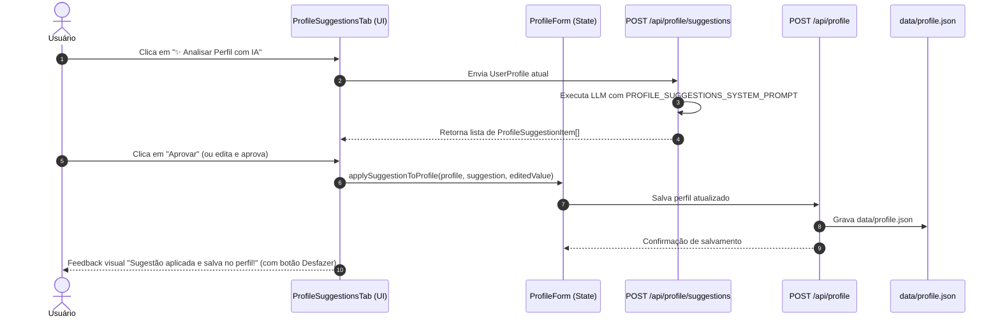

# Design Spec: Copiloto de Sugestões de Edição no Perfil Mestre

## 1. Visão Geral e Contexto
O Perfect CV utiliza o **Perfil Mestre** (`data/profile.json`) como a base única de dados e histórico profissional do usuário. Quando o perfil está incompleto, contém erros de redação ou não detalha habilidades essenciais implícitas no histórico, as gerações de currículo ficam prejudicadas.

Este recurso introduz um **Copiloto de Auditoria e Sugestões da IA** diretamente na aba "Meu Perfil", oferecendo uma aba interativa chamada **"✨ Sugestões da IA"**. O usuário recebe recomendações acionáveis em formato de linhas, podendo **Aprovar**, **Editar** ou **Rejeitar** cada item individualmente, com aplicação imediata e salvamento automático no perfil mestre.

---

## 2. Casos de Uso & Categorias de Sugestões

1. **✍️ Correção de Escrita e Clareza (`grammar_style`)**:
   - Identifica desvios gramaticais, erros de concordância ou ortografia no resumo profissional e nos tópicos das experiências.
   - Mostra o texto original vs. o texto corrigido.
2. **➕ Sugestão de Habilidades a Adicionar (`add_skill`)**:
   - Infere tecnologias, frameworks ou soft skills evidentes nas descrições de cargos e projetos, mas que o candidato não adicionou à lista de habilidades (ex: descreveu "construção de containers e deploys em Kubernetes", mas não listou "Docker" ou "Kubernetes" em ferramentas).
3. **➖ Sugestão de Habilidades a Remover ou Otimizar (`remove_skill`)**:
   - Detecta termos vazios, genéricos ou redundantes que poluem o perfil (ex: habilidades duplicadas com grafias diferentes, termos obsoletos ou generalistas demais como "Informática").
4. **🚀 Aprimoramento de Impacto e Verbos de Ação (`improve_highlight` / `improve_summary`)**:
   - Transforma bullets passivos (ex: *"Responsável pela gestão de banco de dados"*) em frases assertivas de alto impacto (ex: *"Otimizou queries e geriu infraestrutura de bancos relacionais PostgreSQL"*).

---

## 3. Modelo de Dados (`lib/ai/schemas.ts`)

```ts
export const SuggestionTypeEnum = z.enum([
  'grammar_style',
  'add_skill',
  'remove_skill',
  'improve_highlight',
  'improve_summary',
]);

export const ProfileSuggestionItemSchema = z.object({
  id: z.string(),
  type: SuggestionTypeEnum,
  title: z.string(),
  reason: z.string(),
  targetField: z.enum([
    'personalInfo.summary',
    'skills.technical',
    'skills.toolsAndCloud',
    'skills.softSkills',
    'experiences.highlight',
  ]),
  targetIndex: z.number().optional(), // ex: índice da experiência
  subIndex: z.number().optional(),    // ex: índice do highlight dentro da experiência
  originalValue: z.string().optional().default(''),
  suggestedValue: z.string(),
  skillCategory: z.enum(['technical', 'toolsAndCloud', 'softSkills']).optional(),
  status: z.enum(['pending', 'accepted', 'rejected']).default('pending'),
});

export const ProfileSuggestionsResponseSchema = z.object({
  overallSummary: z.string(),
  suggestions: z.array(ProfileSuggestionItemSchema).default([]),
});

export type ProfileSuggestionItem = z.infer<typeof ProfileSuggestionItemSchema>;
export type ProfileSuggestionsResponse = z.infer<typeof ProfileSuggestionsResponseSchema>;
```

---

## 4. Arquitetura e Fluxo de Dados



---

## 5. Aplicação Determinística de Sugestões (`lib/profile/suggestion-applier.ts`)

Criaremos um módulo com funções puras e testes dedicados:
- `applySuggestionToProfile(profile: UserProfile, suggestion: ProfileSuggestionItem, customValue?: string): UserProfile`:
  - `add_skill`: Adiciona o valor à categoria correspondente em `profile.skills[category]`, evitando duplicação (case-insensitive).
  - `remove_skill`: Remove o item de `profile.skills[category]`.
  - `improve_summary`: Atualiza `profile.personalInfo.summary`.
  - `improve_highlight`: Atualiza `profile.experiences[targetIndex].highlights[subIndex]`.
  - `grammar_style`: Atualiza o campo correspondente.
- `revertSuggestionFromProfile(profile: UserProfile, suggestion: ProfileSuggestionItem): UserProfile`:
  - Permite desfazer a alteração caso o usuário clique em "Desfazer".

---

## 6. Design da Interface do Usuário (`ProfileSuggestionsTab`)

- **Aba destacada no `ProfileForm`**:
  - Nova aba com ícone `Sparkles` e contador dinâmico de sugestões pendentes (ex: `✨ Sugestões da IA (5)`).
- **Barra de Ações do Topo**:
  - Botão principal: `✨ Analisar Perfil com IA` (com spinner e mensagem amigável durante análise).
  - Filtros rápidos em pills: `Todas`, `✍️ Escrita`, `➕ Habilidades`, `➖ Remoções`, `🚀 Impacto`.
- **Linha de Sugestão Interativa**:
  - Badge de categoria visual (verde para adição, âmbar/vermelho para remoção, azul para escrita, roxo para impacto).
  - Título objetivo e contexto do perfil.
  - Justificativa da IA: *"Você descreveu criação de microsserviços em Go na empresa X, mas a linguagem Go não consta nas suas habilidades técnicas."*
  - Bloco de **Antes vs. Depois**:
    - Se for edição de texto: exibição clara do trecho anterior e da proposta aprimorada.
    - Se for adição/remoção de tag: visualização em badge de skill.
  - **Ações por linha**:
    - Botão verde ✅ **Aprovar**: aplica imediatamente e salva.
    - Botão cinza/azul ✏️ **Editar**: abre um input inline onde o usuário pode alterar o texto sugerido antes de aprovar.
    - Botão vermelho/cinza ❌ **Rejeitar**: descarta a sugestão e marca como rejeitada.
  - **Estado pós-aprovação**:
    - Mostra feedback *"Aplicado ao perfil com sucesso!"* com botão `Desfazer`.

---

## 7. Critérios de Sucesso e Testabilidade

1. **Testes Unitários da Aplicação de Sugestões**:
   - Testar adição de habilidade em cada categoria sem duplicidade.
   - Testar remoção de habilidade existente.
   - Testar substituição de texto de resumo e de bullet de experiência.
   - Testar reversão (desfazer).
2. **Testes de Schemas e Prompts**:
   - Validar que o prompt gera saídas em conformidade estrita com o Zod schema.
3. **Testes de Componente**:
   - Renderização das linhas com botões Aprovar, Editar e Rejeitar.
   - Alternância para o modo de edição inline.
4. **Verificação de Tipagem e Build**:
   - `npx tsc --noEmit` sem erros.
   - `npm test` 100% passando.
